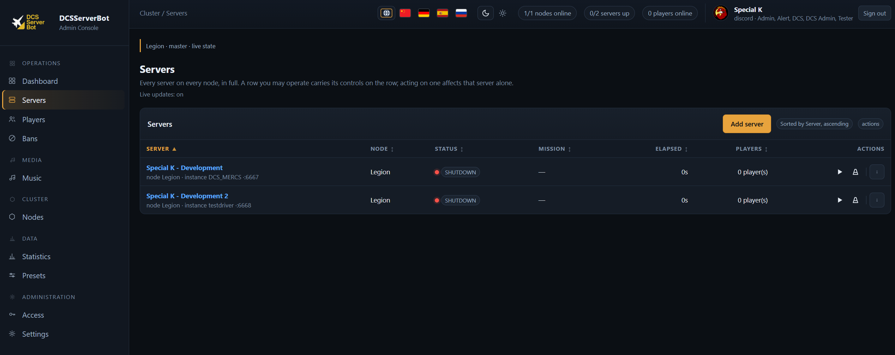

# Welcome to DCSServerBot!

**Manage your DCS World servers from Discord — or entirely without it.**

DCSServerBot runs your missions, watches your servers and keeps the statistics, so you do not have to
sit in front of the machine. One server on one PC, or a cluster spread over several nodes: the same
bot, the same commands.

<!-- Screenshot: the website dashboard with two running servers -->

**What it does out of the box:**

- **Runs your servers** — mission rotation, restarts, shutdowns, gated on players being online
- **Watches them** — availability, performance and traffic-light status per server
- **Keeps the record** — per-player and per-server statistics, logbook, credits, awards
- **Admins the players** — bans, punishment, slot blocking, in-game chat commands
- **Reaches out** — SRS, LotAtc, Tacview, DCS Olympus, MOOSE and your own scripts

## Two ways to drive it

**Discord** — slash commands, embeds, buttons and menus in your server. The default.

**The website** — an admin UI served by the bot itself, with a login of its own, so an installation
can be operated by someone who has no Discord account at all.

## Install in five steps

1. Install [Python 3.11+](https://www.python.org/downloads/) and
   [PostgreSQL](https://www.postgresql.org/download/).
2. Get the code: `git clone https://github.com/Special-K-s-Flightsim-Bots/DCSServerBot.git`
3. Create a bot at <https://discord.com/developers> and copy its token.
4. Run `run.cmd` (Windows) or `./run.sh` (Linux) — a setup tour opens in your browser and writes the
   configuration for you.
5. Point it at your missions and start it.

**[→ Full installation guide](https://special-k-s-flightsim-bots.github.io/DCSServerBot/install/)**

## Documentation

Everything past the first install lives on the documentation site. It is generated from the files in
this repository, so a correction is a pull request on a page — not a website edit.

| You want to … | Read |
|:--------------|:-----|
| Install it, or fix an installation | [Installation](https://special-k-s-flightsim-bots.github.io/DCSServerBot/install/) |
| Change a setting | [Configuration](https://special-k-s-flightsim-bots.github.io/DCSServerBot/configure/) |
| Look up a configuration key | [Configuration reference](https://special-k-s-flightsim-bots.github.io/DCSServerBot/reference/config/main/) |
| Know what a command does | [Command reference](https://special-k-s-flightsim-bots.github.io/DCSServerBot/reference/commands/) |
| See which plugins and extensions exist | [Components](https://special-k-s-flightsim-bots.github.io/DCSServerBot/guides/components/) |
| Give people roles and permissions | [Roles and permissions](https://special-k-s-flightsim-bots.github.io/DCSServerBot/guides/roles/) |
| Link players to Discord | [Player linking](https://special-k-s-flightsim-bots.github.io/DCSServerBot/guides/player-linking/) |
| Send messages from a mission | [Mission scripting](https://special-k-s-flightsim-bots.github.io/DCSServerBot/guides/mission-scripting/) |
| Run several servers or nodes | [Several servers](https://special-k-s-flightsim-bots.github.io/DCSServerBot/guides/multiple-servers/) · [Multi-node](https://special-k-s-flightsim-bots.github.io/DCSServerBot/multinode/) |
| Build your own plugin or extension | [Developing](https://special-k-s-flightsim-bots.github.io/DCSServerBot/developers/overview/) |
| Take part in the global ban lists | [DGSA](https://special-k-s-flightsim-bots.github.io/DCSServerBot/community/dgsa/) |

## Support

Join the [support Discord](https://discord.gg/h2zGDH9szZ) to ask questions, report bugs or talk to
other admins. If you enjoy what this does, you can support it on
[Patreon](https://www.patreon.com/DCS_SpecialK) or
[buy me a coffee](https://buymeacoffee.com/special_k).

## Credits

Thanks to the developers of [HypeMan](https://github.com/robscallsign/HypeMan) and
[perun](https://github.com/szporwolik/perun), who gave me the main ideas for this solution — the few
places where I borrowed ideas or code are marked in the source. Thanks also to Moose for aligning the
[FunkMan](https://github.com/funkyfranky/FunkMan) API with me and making it compatible in the first
place.
